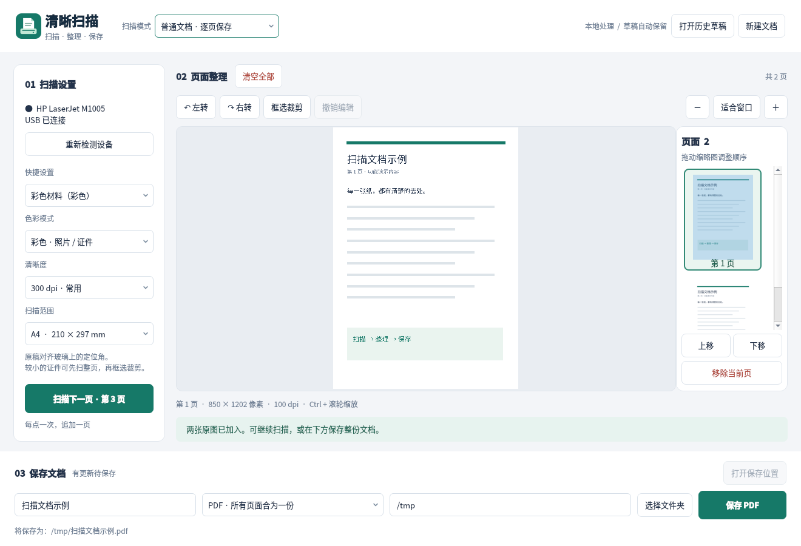
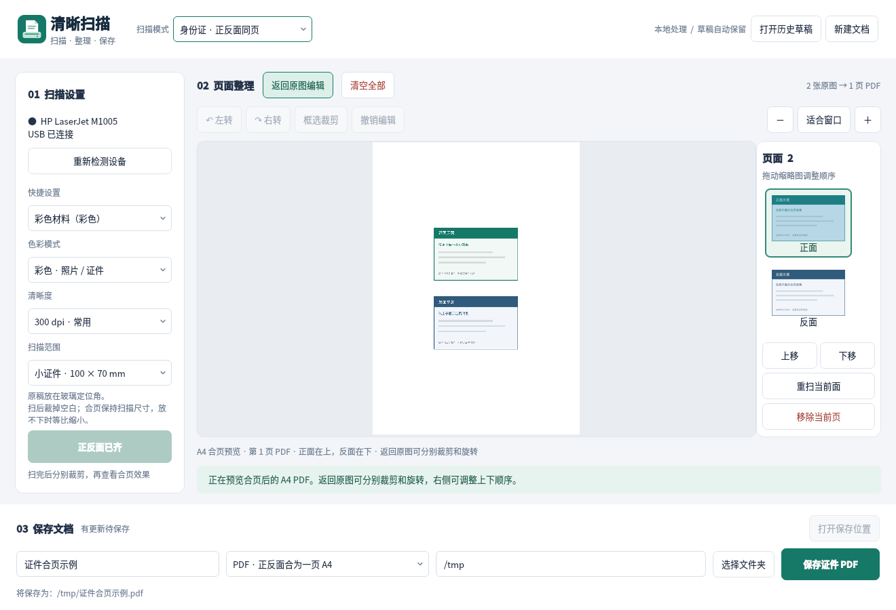

<div align="center">


# 清晰扫描

**从一张纸，到一份好保存的文件。**

面向统信 UOS 和 HP LaserJet M1005 的中文桌面扫描工具。<br>
扫描设置看得见，页面顺序可调整，保存位置说清楚。<br>
身份证正反面、户口本页面，也能合排到同一张 A4 上。

[](https://github.com/realstephenxu/qingxi-scan/releases/latest)


[下载安装包](https://github.com/realstephenxu/qingxi-scan/releases/latest) · [证件怎么扫](#身份证正反面合为一页) · [常见问题](#常见问题) · [反馈问题](https://github.com/realstephenxu/qingxi-scan/issues)

</div>

## 扫描、整理、保存，在一个窗口里完成



| 你想做的事 | 在清晰扫描里 |
| --- | --- |
| 扫一份多页材料 | 换纸后继续扫描，每次追加一页，最后合成一份 PDF |
| 调整歪放或多余的画面 | 大图预览，分别旋转、框选裁剪，编辑可以撤销 |
| 把页面排好顺序 | 拖动缩略图，或点击“上移”“下移” |
| 复印身份证正反面 | 按提示扫两面，预览后保存为同一页 A4 PDF |
| 整理户口本 | 按扫描顺序，每两页上下合排为一页 A4 |
| 明确文件存到哪里 | 保存前显示完整路径；已有同名文件会保留并提示改名 |
| 开始下一份材料 | 点击“清空全部”，保留扫描设置和保存位置，当前窗口内可以撤销 |
| 下次接着处理 | 本地自动保留草稿，可打开历史草稿继续编辑 |

## 下载与安装

**已验证的运行环境：统信 UOS Desktop 20 E，x86_64；扫描设备：通过 USB 连接的 HP LaserJet M1005。** 其他系统版本和硬件架构尚未验证，目前不提供 Windows、macOS 或其他扫描仪的支持。

1. 打开 [最新版本](https://github.com/realstephenxu/qingxi-scan/releases/latest)，下载 `qingxi-scan_1.1.1_all.deb`。需要说明和源码时，可下载完整分发压缩包。
2. 双击 DEB 文件，使用系统安装器完成安装。缺少运行组件时需要联网，让系统安装依赖。
3. 打开 M1005 电源，接好 USB，在启动器搜索 **“清晰扫描”**。

程序依赖系统中的 Python 3、PyQt5、Pillow、ReportLab 和 SANE 扫描组件。安装包会声明这些依赖，但不包含独立的离线运行环境。扫描功能还需要系统中的 `hpljm1005` 驱动和 USB 访问权限。

<details>
<summary>使用终端安装</summary>

在安装包所在文件夹打开终端：

```bash
sudo apt install ./qingxi-scan_1.1.1_all.deb
```

安装后也可以输入 `qingxi-scan` 启动。

</details>

## 第一次扫描

**放好原稿 → 扫描 → 检查页面 → 选择保存位置 → 保存。**

普通文件可从 **灰度、300 dpi、A4** 开始；有照片、彩色印章或彩色内容时，改用彩色模式。

将原稿对齐扫描玻璃上的定位角，点击左侧 **“扫描第 1 页”**。需要扫描多页时，换好下一张，再点 **“扫描下一页”**。中间查看大图，右侧检查顺序。

保存时，在窗口下方填写文件名、选择格式和文件夹，核对显示的完整路径，再点击保存：

| 保存格式 | 得到什么 |
| --- | --- |
| PDF | 按页面顺序合成一份文档 |
| JPG | 新建一个文件夹，每页一张图片，依次命名为 `001.jpg`、`002.jpg`… |
| PNG | 新建一个文件夹，每页一张图片，依次命名为 `001.png`、`002.png`… |

## 身份证正反面合为一页



*界面截图中的卡片仅用于演示，不含真实证件信息。*

1. 在窗口顶部选择 **“身份证 · 正反面同页”**。已有材料需要保留时，可先点“新建文档”。
2. 将证件正面朝下，放在扫描玻璃的定位角，点击 **“扫描正面”**。新建的证件文档默认使用彩色 300 dpi，扫描范围为 **100 × 70 mm**。
3. 翻面后点击 **“扫描反面”**。分别选中右侧的正面、反面，在大图中裁掉多余空白，并转到正确方向。
4. 点击 **“查看合页效果”**，检查 A4 纸上正面在上、反面在下。需要修改时，点 **“返回原图编辑”**。
5. 选择文件名和保存文件夹，点击 **“保存证件 PDF”**，得到 **一页包含正反面的 A4 PDF**。

某一面没扫好时，选中它，点击 **“重扫当前面”**；只有新扫描成功后才会替换原面，取消或失败时保留原图。已经扫描好的两张图片，也可以直接切换到证件模式合页，无需重新扫描。

合页不会拉伸或自动放大图像；程序按扫描清晰度计算尺寸，放不下时等比缩小。**请先裁掉证件以外的空白**，以便检查尺寸和位置。当前版本不自动识别证件边界，也不提供 OCR。

## 户口本两页合排

在顶部选择 **“户口本 · 两页合排”**，按需要的顺序逐页扫描，分别裁剪、转正，再查看合页效果。

- 第 1、2 张原图排在第 1 页 A4 上；第 3、4 张排在第 2 页，以此类推。
- 每页按 **先上后下** 排列，调整右侧缩略图顺序即可改变组合。
- 原图数量为奇数时，最后一张单独排在末页，不会丢弃。
- 选中右侧不同页面，可查看它所在的那张 A4。

例如，扫描 5 张原图，最终保存为 **3 页 PDF**。两种合页模式均输出 PDF；需要逐页图片时，请切回普通文档模式。

## 常见问题

### 找不到扫描仪，或者提示设备被占用？

确认 M1005 已开机、USB 连接正常，关闭其他扫描软件，再点击 **“重新检测设备”**。如果其他扫描软件也无法使用，需要先检查系统驱动或 USB 权限；本程序不会代替系统安装厂商驱动。

### 扫完之后，怎么清空并重新开始？

点击“页面整理”旁的 **“清空全部”**，即可移除当前文档的所有页面，重新生成文件名，并保留扫描模式、清晰度和保存文件夹。已导出的 PDF、图片不会被删除。误清空时，在当前窗口点击右侧 **“撤销清空”**，可一次恢复原来的页面顺序和编辑。

### 关闭窗口后，刚才扫的内容还在吗？

扫描和编辑会自动保留在本机草稿中，再次打开可继续处理。新建文档时，上一份草稿仍可通过 **“打开历史草稿”** 找回。**草稿保留不等于已导出文件**；需要提交、发送或归档的材料，请点击保存。

### 扫描页会上传到网上吗？

扫描、预览、编辑和导出都在本机完成，不需要登录，也不使用云端扫描服务。草稿默认保存在当前用户的 `~/.local/share/qingxi-scan/` 下；导出的文件保存在界面中选择的文件夹。

### 为什么保存时提示名称已存在？

程序会保留已有文件。修改文件名，或换一个保存文件夹，再点击保存即可。

### 可以把正反面互换位置吗？

可以。调整右侧两张缩略图的顺序，再查看合页效果。列表第一张排在上方，第二张排在下方。

### 支持自动进纸、双面进纸或文字识别吗？

当前版本面向 M1005 的平板逐页扫描，支持手动翻面；暂不包含自动进纸、自动纠偏或 OCR。

## 小提示

| 快捷键 | 操作 |
| --- | --- |
| `Ctrl + Enter` | 开始扫描 |
| `Ctrl + S` | 保存文件 |
| `Ctrl + 滚轮` | 缩放预览 |

遇到问题，可以在 [Issues](https://github.com/realstephenxu/qingxi-scan/issues) 里说明系统版本、设备型号、操作步骤和错误提示。涉及证件或个人信息的截图，请先遮盖敏感内容。

<details>
<summary>源码运行、功能测试与重新打包</summary>

安装系统依赖后，在项目文件夹运行：

```bash
/usr/bin/python3 app.py
```

功能测试使用生成的示例图片和模拟扫描仪，不会启动真实扫描；测试还需要 `poppler-utils` 提供的 PDF 检查工具：

```bash
QT_QPA_PLATFORM=offscreen /usr/bin/python3 -m unittest -v test_app
```

重新生成 DEB 和完整分发压缩包，需要系统中的 `dpkg-deb`：

```bash
/usr/bin/python3 build_dist.py ./dist
```

打包脚本只收集明确列出的程序、图片和文档，不会打包扫描页、草稿、锁文件或缓存。同名分发成果存在时会停止，避免覆盖已有版本。

</details>
